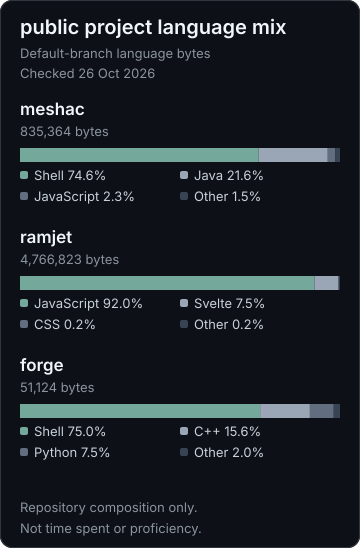

# luke / goattech

i play games, write code, and build things for FIRST.

## projects
- [meshac](https://github.com/GoatTech-42/meshac) - a native fabric anticheat.
- [ramjet](https://github.com/GoatTech-42/ramjet) - a self-hosted proxy browser.
- [forge](https://github.com/GoatTech-42/goattech-forge) - experimental firmware for the ender 3 v3 se.

## language mix

Default-branch language bytes, not time spent or proficiency. Checked 26 Oct 2026. Sources: [meshac](https://api.github.com/repos/GoatTech-42/meshac/languages) · [ramjet](https://api.github.com/repos/GoatTech-42/ramjet/languages) · [forge](https://api.github.com/repos/GoatTech-42/goattech-forge/languages).
