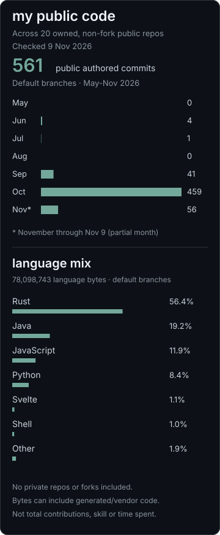

# luke / goattech

i play games, write code, and build things for FIRST.

## projects
- [meshac](https://github.com/GoatTech-42/meshac) - a native fabric anticheat.
- [ramjet](https://github.com/GoatTech-42/ramjet) - a self-hosted proxy browser.
- [forge](https://github.com/GoatTech-42/goattech-forge) - experimental firmware for the ender 3 v3 se.
- [goattech launcher](https://github.com/GoatTech-42/goattech-launcher) - a minecraft launcher forked from horizon: rust engine and java instances side by side, fabric/quilt + modrinth. in development.

## my public code

<picture>
  <source media="(min-width: 700px)" srcset="public-overview-wide-2026-11-09.svg">
  
</picture>

Public repos only. Activity counts unique commits attributed to GoatTech-42 on default branches, by author date (Los Angeles), May 10-Nov 9, 2026. Not all GitHub contributions. Language mix sums GitHub language bytes across all 20 owned non-fork public repos; generated/vendor code may count. Private repos and public forks are excluded. Checked Nov 9, 2026. [Public repositories](https://github.com/GoatTech-42?tab=repositories).
