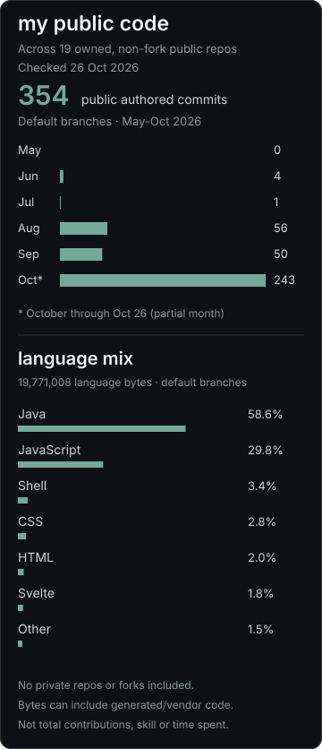

# luke / goattech

i play games, write code, and build things for FIRST.

## projects
- [meshac](https://github.com/GoatTech-42/meshac) - a native fabric anticheat.
- [ramjet](https://github.com/GoatTech-42/ramjet) - a self-hosted proxy browser.
- [forge](https://github.com/GoatTech-42/goattech-forge) - experimental firmware for the ender 3 v3 se.

## my public code

Public repos only. Activity counts unique commits attributed to GoatTech-42 on default branches, by author date (Los Angeles), May 1-Oct 26, 2026. Not all GitHub contributions. Language mix sums GitHub language bytes across all 19 owned non-fork public repos; generated/vendor code may count. Private repos and the one public fork are excluded. Checked Oct 26, 2026. [Public repositories](https://github.com/GoatTech-42?tab=repositories).
